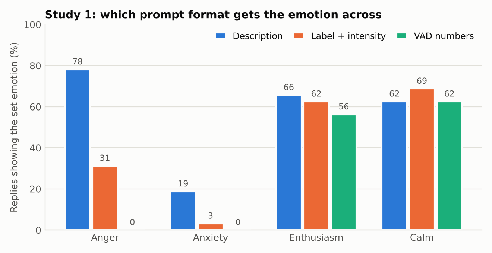
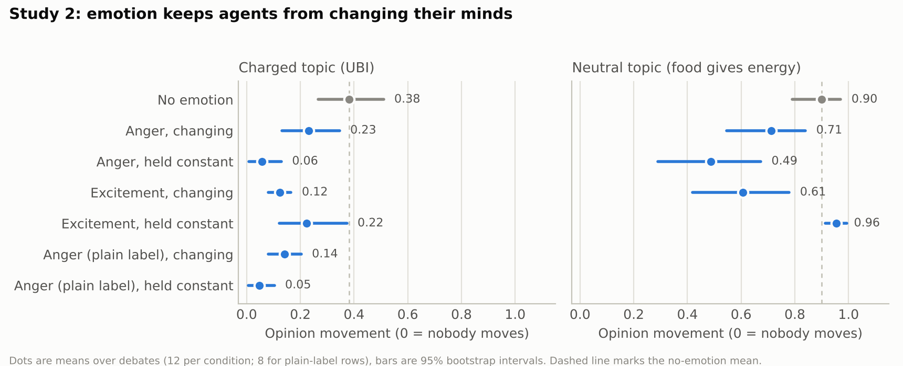
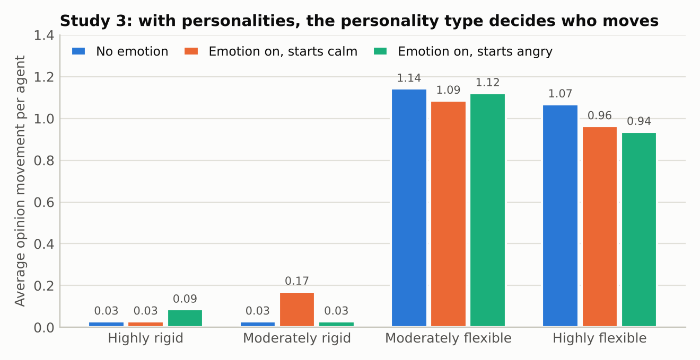

# EMPATH results (Nov 11 to 13, 2026)

Model: gpt-oss-20b for both the agents and the judge, run with Ollama on NC State VCL machines (RTX 2080 Ti and L40S). Context limit 32,000 tokens. All logs are in `results/`.

## Short version

1. **How to give an agent an emotion.** A one-sentence description works best. A label with an intensity number works about half as well. VAD numbers do nothing.
2. **Emotion alone.** Emotional agents change their minds less. Anger held constant stops opinion change almost completely. This holds with a plain label too, so it is not caused by the wording of the description.
3. **Emotion plus personality.** Personality decides who moves. Adding emotion on top made no measurable difference.

## Setup used for Studies 2 and 3

Four agents debate for 24 messages (6 rounds). Two start for the statement and two against.

Three things differ from the original framework. They came out of a calibration step run on no-emotion debates only (21 debates, `results/calibration/`).

| Change | Why |
|---|---|
| Brief rules: the prompt states the agent's current position in words, forbids planning talk, and caps replies at 120 words | Without them, agents ignored their assigned side about half the time and wrote 400-word essays |
| Private belief check: before each turn the agent is told where it stood and asked where it stands now (-1 to 1). Nobody else sees the answer | The judge's score was almost always exactly +1 or -1, so it could not show small shifts |
| The agent's own answer becomes its position for that turn | With the position fixed in the prompt, agents never moved. With the position given only as a number, the "disagree" agents flipped to agree on their first turn. This was the only setup with gradual movement |

Calibration numbers (opinion movement: 0 = nobody moves, about 1 = everyone ends on one side):

| Setup | Round-1 side held | Movement |
|---|---|---|
| Original prompt, judge score fed back | 67% | 1.05 |
| Soft rules | 100% | 0.00 |
| Soft or strict rules, judge score fed back | 92 to 100% | 0.17 |
| Rules, agent's own answer, position still stated in the check | 100% | 0.00 |
| Soft rules, open belief check | 92% | 0.58 |
| **Brief rules, open belief check (used)** | 92% | 0.39 |

The rule for picking the setup was changed after seeing these numbers (from "movement closest to 0.5" to "movement between 0.25 and 0.75, then shortest messages"). Only no-emotion debates were used, so it does not bias the emotion comparisons, but it should be stated in the paper.

## Study 1: how to represent an emotion (352 single replies)

One agent hears one attack on its side and writes one reply. Its emotion is set directly, in one of three formats, at low or high intensity. The judge then names the emotion the reply shows.

| Format | Replies showing the set emotion | Anger | Anxiety | Enthusiasm | Calm |
|---|---|---|---|---|---|
| Description | 55% (62/112) | 25/32 | 6/32 | 21/32 | 10/16 |
| Label + intensity | 38% (42/112) | 10/32 | 1/32 | 20/32 | 11/16 |
| VAD numbers | 25% (28/112) | 0/32 | 0/32 | 18/32 | 10/16 |

- **VAD numbers have no effect.** Replies given VAD numbers are rated the same as replies given no emotion (valence +0.41 to +0.50, arousal near 0). VAD is still useful for tracking and plotting an agent's state.
- **Anger is the only emotion that comes through strongly.** With a description, angry replies are rated unpleasant (valence -0.12), worked up (arousal +0.62) and intense (0.68, against 0.33 with no emotion).
- **Anger hardens the stance.** The judge scores angry replies at +0.93 for the agent's side, against +0.42 with no emotion.
- **Anxiety barely shows** in any format (6/32 at best).
- **Intensity matters only with a description** (anger: 0.60 low, 0.76 high). Label and VAD show no difference between low and high.

## Study 2: emotion only, no personality (136 debates)

Agents have no personality, only a name and an emotion-regulation level (high or low). Emotion is either off, on (it changes each turn from how the agent appraises the last message), or held constant at its starting value.

Opinion movement per debate, with a permutation test against the no-emotion condition:

| Condition | UBI (charged) | p | Food (neutral) | p |
|---|---|---|---|---|
| No emotion | 0.38 | | 0.90 | |
| Anger, changing | 0.23 | 0.10 | 0.71 | 0.05 |
| Anger, held constant | 0.06 | 0.0001 | 0.49 | 0.002 |
| Excitement, changing | 0.12 | 0.0008 | 0.61 | 0.02 |
| Excitement, held constant | 0.22 | 0.11 | 0.96 | 0.41 |
| Anger with plain label, changing | 0.14 | 0.01 | not run | |
| Anger with plain label, held constant | 0.05 | 0.001 | not run | |

12 debates per condition, 8 for the plain-label rows.

- **Emotion reduces opinion change on the charged topic.** Every emotion condition is below the no-emotion mean. Anger held constant and changing excitement are clear after correcting for the ten comparisons; the others are in the same direction but not individually reliable.
- **Constant anger nearly freezes opinions** (0.06 against 0.38), and agents end almost as far apart as they started (final spread 0.96 against 0.72).
- **Not a wording effect.** The description for anger includes "you want to push back hard". The plain label has no such phrase and gives the same result.
- **On a statement everyone accepts, anger blocks agreement.** Without emotion nearly everyone converges (0.90). With constant anger, movement drops to 0.49. Constant excitement does not block agreement (0.96).
- **The starting mood washes out when emotion is allowed to change.** In "on" debates the emotion mix ends up the same whether agents start angry or excited: about 61 to 65% anger, 25% enthusiasm, the rest anxiety. Debating against opposition makes these agents angry.
- **Regulation works on emotion, but not visibly on opinion.** Low-regulation agents run hotter (intensity 0.71 against 0.43). Their opinions move slightly less, but the same gap appears with emotion off, so it comes from the individual agents, not from regulation.
- **Emotion check.** How often a message shows the intended emotion ranges from 51% to 97% by condition. It is highest for constant anger (96 to 97%) and lowest for constant excitement on UBI (51%): agents told they are excited do not sound excited while being attacked.

## Study 3: personality plus emotion (24 debates, same 8 MBTI groups in each condition)

| Condition | Movement per debate | Paired difference from no emotion |
|---|---|---|
| No emotion | 0.63 | |
| Emotion on, starts calm | 0.61 | -0.02 (p = 0.61) |
| Emotion on, starts angry | 0.59 | -0.04 (p = 0.38) |

- **Personality decides who moves.** Flexible types move about 1.0 on average and rigid types about 0.03, in every condition. This matches the flexibility ordering in the original paper.
- **Emotion adds nothing measurable** on top of personality with 8 groups. The personality text in the prompt appears to override the emotion sentence.
- The emotion check is lower here (about 61%) than in Study 2.

## Study 0 rerun: the original setup at the 32,000-token limit (24 debates)

| Topic | Final opinion, earlier run | Final opinion, 32k rerun |
|---|---|---|
| Universal (food) | +0.89 | +0.88 |
| Debatable (UBI) | +0.26 | +0.15 |
| Controversial (colonize planets) | -0.53 | -0.50 |

Late-round prompts in the original setup pass 16,000 tokens, and anything over the model's limit is cut from the front, which removes the agent's instructions. The rerun shows this did not change the overall pattern. In both runs agents argue their assigned side only about half the time in round 1.

## Limits

- One model, and the same model is the judge. No human has checked the emotion labels or opinion scores.
- Two topics, and 8 to 12 debates per condition.
- The belief measure is the agent's own answer. The judge-based measure gives the same pattern in Study 2 (for example 0.38 against 0.04 for constant anger on UBI).
- The setup differs from the original framework (see the first table).
- In the original code every earlier message is shown to the model as if the agent itself had said it, with no speaker names. This was left unchanged.
- Study 3 has 8 groups per condition and highly rigid and highly flexible types are unevenly represented (7 to 11 agents per tier).
